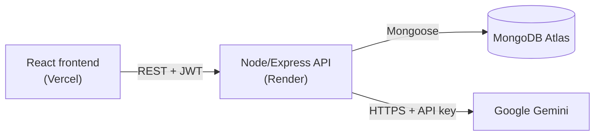

# Paidly: Home Repair Booking with an AI Quote Builder

Paidly is a full-stack web app for booking home repair and handyman services. Customers browse services, book a date and time, and manage their bookings. They can also describe a problem in plain English ("my kitchen faucet drips and the bathroom fan is loud") and get an instant AI estimate built from the real service catalog.

- **Live app:** https://paidly-henna.vercel.app
- **Backend API:** https://paidly-api-4yu7.onrender.com/api/health
- **Repository:** https://github.com/patohdzz/paidly

> The backend runs on Render's free plan, so the first request after a period of inactivity can take up to a minute while the server wakes up.

## Problem and target users

Homeowners often don't know which repair service they need or what it will cost, and booking a handyman usually means phone calls and waiting for a quote. Paidly lets them see clear prices, get an estimate in seconds, and book online.

- **Customers:** browse services, get AI estimates, book, reschedule, and cancel appointments.
- **Admin (business owner):** reviews and confirms bookings, marks jobs complete, and manages the service catalog.

## Key features

- **Authentication:** register, log in, log out, with protected pages and role-based access (customer and admin).
- **Service browsing:** search, category filters, and a details page with price, duration, category, and description.
- **Booking:** pick a date and time, add an address and notes. The server blocks double-booking of overlapping time slots.
- **My Bookings:** upcoming and past bookings, with reschedule and cancel.
- **Admin dashboard:** see all bookings, confirm, complete, or cancel them, and add, edit, or delete services.
- **AI Quote Builder:** describe the problem and get an itemized estimate with tax.
- **Responsive design:** works on desktop and phone, with a slide-in menu on small screens.

## AI-powered feature: AI Quote Builder

The customer types a description of the problem. The backend sends it to **Google Gemini** along with the list of active services (names and IDs only, no prices). Gemini must answer in a fixed JSON format and can only choose service IDs from that list.

The server then builds the estimate itself:

1. It drops any service ID that doesn't exist, is inactive, or is repeated.
2. It limits quantities and keeps at most 5 line items.
3. It takes **all prices from the database**, never from the AI, and adds 8.25% tax.

If Gemini is slow (over 15 seconds), fails, or returns something invalid, the server falls back to keyword matching, so the customer still gets an estimate. The result shows an **AI estimate** or **Quick estimate** badge so the user knows which one they got. Each customer can request up to 10 quotes per 15 minutes.

**Limitations:** the estimate is a starting point, not a final price. It only covers services in the catalog, and the AI can misread vague descriptions.

## Architecture

Paidly uses a three-tier architecture. React never talks to MongoDB or Gemini directly, so no secrets reach the browser.



| Layer | Technology | Responsibility |
| --- | --- | --- |
| Presentation | React 19, Vite, React Router, Bootstrap 5, Bootstrap Icons | Pages, forms, routing, and calls to the API |
| Application | Node.js, Express 5 | REST routes, validation, auth, booking rules, AI service |
| Data | MongoDB Atlas, Mongoose | Users, services, and bookings |

## Tech stack

- **Frontend:** React, Vite, React Router, Bootstrap 5, Bootstrap Icons, Context API
- **Backend:** Node.js, Express, Mongoose, bcryptjs, jsonwebtoken, helmet, cors, express-rate-limit, dotenv
- **Database:** MongoDB Atlas
- **AI:** Google Gemini API (called from the backend)
- **Deployment:** Vercel (frontend), Render (backend), MongoDB Atlas (database)
- **Tools:** Git and GitHub, Postman, MongoDB Compass, VS Code

## Folder structure

```
paidly/
├── client/                 React frontend
│   └── src/
│       ├── api/            API helper and endpoint functions
│       ├── components/     Reusable UI (cards, forms, sidebar, layout)
│       ├── context/        Auth context and provider
│       ├── hooks/          useAuth, useApiData
│       ├── pages/          One file per screen
│       └── utils/          Formatting and helper functions
└── server/                 Express backend
    ├── scripts/            Seed services and create the admin user
    └── src/
        ├── ai/             Gemini provider
        ├── config/         MongoDB connection
        ├── controllers/    Request handlers
        ├── middleware/     Auth, roles, rate limits
        ├── models/         User, Service, Booking
        ├── routes/         REST routes
        ├── services/       Booking and quote business logic
        ├── utils/          Small helpers
        └── validators/     Request body validation
```

## Run it locally

### Prerequisites

- Node.js 20 or newer
- A MongoDB Atlas cluster (or local MongoDB)
- A Google Gemini API key (optional: without one, the AI Quote Builder uses the keyword fallback)

### 1. Clone and install

```bash
git clone https://github.com/patohdzz/paidly.git
cd paidly
cd server && npm install
cd ../client && npm install
```

### 2. Environment variables

Copy each `.env.example` to `.env` and fill in your own values. Never commit `.env` files.

**server/.env**

| Variable | Purpose |
| --- | --- |
| `PORT` | API port (default 5000) |
| `NODE_ENV` | `development` or `production` |
| `MONGODB_URI` | MongoDB connection string |
| `CLIENT_ORIGIN` | Frontend URL allowed by CORS (e.g. `http://localhost:5173`) |
| `JWT_SECRET` | Long random string used to sign login tokens |
| `JWT_EXPIRES_IN` | Token lifetime (e.g. `1d`) |
| `ADMIN_NAME`, `ADMIN_EMAIL`, `ADMIN_PASSWORD` | Used by the create-admin script |
| `AI_PROVIDER` | `gemini` |
| `AI_MODEL` | Gemini model ID |
| `AI_API_KEY` | Gemini API key (backend only) |

**client/.env**

| Variable | Purpose |
| --- | --- |
| `VITE_API_BASE_URL` | Backend API URL (e.g. `http://localhost:5000/api`) |

### 3. Seed the database and create an admin

From `server/`:

```bash
npm run seed           # adds 10 home repair services
npm run create-admin   # creates the admin account from ADMIN_* variables
```

### 4. Start the backend

From `server/`:

```bash
npm run dev
```

The API runs at http://localhost:5000. Check http://localhost:5000/api/health.

### 5. Start the frontend

From `client/` in a second terminal:

```bash
npm run dev
```

Open http://localhost:5173. Register a customer account to book services and use the AI Quote Builder.

## API summary

All routes start with `/api`. Protected routes need an `Authorization: Bearer <token>` header.

| Method | Route | Access | Description |
| --- | --- | --- | --- |
| GET | `/health` | Public | Server and database status |
| POST | `/auth/register` | Public | Create a customer account |
| POST | `/auth/login` | Public | Log in and get a token |
| GET | `/auth/me` | Logged in | Current user |
| GET | `/services` | Public | Active services |
| GET | `/services/:id` | Public | One service |
| GET | `/services/admin/all` | Admin | All services, including inactive |
| POST | `/services` | Admin | Create a service |
| PATCH | `/services/:id` | Admin | Update a service |
| DELETE | `/services/:id` | Admin | Delete a service |
| POST | `/bookings` | Customer | Create a booking |
| GET | `/bookings/mine` | Customer | My bookings |
| GET | `/bookings` | Admin | All bookings |
| GET | `/bookings/:id` | Owner or admin | One booking |
| PATCH | `/bookings/:id/reschedule` | Customer (owner) | Change the date and time |
| PATCH | `/bookings/:id/cancel` | Owner or admin | Cancel a booking |
| PATCH | `/bookings/:id/status` | Admin | Confirm, complete, or cancel |
| POST | `/ai/quote` | Customer | Get an AI estimate |

## Security

- Passwords are hashed with bcrypt. Password hashes are never returned by the API.
- JWT authentication, with role checks (customer or admin) and ownership checks on bookings.
- Server-side validation of all request bodies and IDs.
- Rate limits on login, registration, and the AI endpoint.
- helmet security headers, CORS limited to the frontend origin, and a 10 KB request body limit.
- Secrets live only in backend environment variables. The AI key is never sent to the browser.
- Admin accounts can only be created with the server script, not through registration.

## Testing

The API was tested with a Postman collection covering authentication, services, bookings (including double-booking and permission errors), and the AI quote endpoint. The main user flows were tested by hand in the browser, locally and on the deployed site, on desktop and mobile widths.

## Deployment

- **Frontend:** Vercel, root directory `client`, build command `npm run build`, environment variable `VITE_API_BASE_URL`. `vercel.json` rewrites all routes to `index.html` so React Router works on refresh.
- **Backend:** Render, root directory `server`, build command `npm install`, start command `npm start`, with the server environment variables set in the Render dashboard.
- **Database:** MongoDB Atlas, with a dedicated database user for the app.

Pushing to `main` redeploys both automatically.

## Known limitations and future improvements

- The backend sleeps on Render's free plan, so the first request can be slow.
- One business, no technician scheduling or availability calendar yet.
- Future ideas: real service photos, email confirmations, online payment, technician accounts, and saving AI quotes to start a booking in one click.

## How AI was used during development

I used AI assistants (Claude) throughout the project as a development helper: planning user stories and the database design, generating starter code for routes, models, and React pages, debugging errors, refactoring, improving the UI, and drafting documentation. I reviewed and tested every piece of AI-generated code before committing it, tested the API in Postman and the app in the browser, and made the final decisions on architecture, security, and features.

## Author

**Patricio Hernandez**: UT Arlington AI-Centric Software Engineering Bootcamp capstone, 2026.
GitHub: [patohdzz](https://github.com/patohdzz)